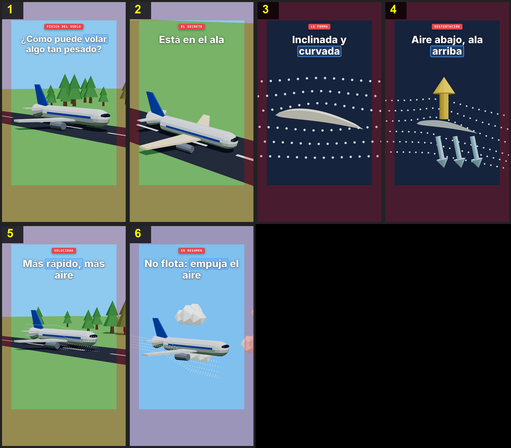

# 3D: usage



3D made entirely with code, in two levels you mix **per object**:
- **Simple:** low-poly with matte materials (flat shading), soft sky light and shadows, cone trees and icosahedron clouds (`library.ts`).
- **Textured:** surfaces painted by shaders (wood, bark, soil, cloth, bamboo, asphalt), fur and grass in layers, organic shapes colored by math, and an image finish with grade, vignette and grain (`detail.ts`).

The rule: **the hero of each scene gets texture, the rest stays simple.** The eye goes to what matters, and the render stays fast (texture costs time: a 2-minute textured video can take 45 minutes).

The titles are HTML on top of the 3D: red label, thick white title with the key word in a blue box, and a dark card with the stat. It runs at 30 fps.

**Good for** physics, machines, vehicles, animals, objects and "how it works" with volume. **Not for** lots of text or flat diagrams (use Flat 2D).

## Steps for a video
1. **Audio.** Put your audio at `videos/<topic>/audio.wav` (or `.mp3`/`.m4a`). If you don't have one, write `script.json` and run `node core/voice.ts videos/<topic>`.
2. **Idea.** Tell the AI what you want to get across and, if you like, colors, tone or scenes. They end up in the `notes` field of `scenes.json`.
3. **Transcribe and analyze.**
   ```bash
   .venv/bin/python core/transcribe.py videos/<topic>
   ```
   ```bash
   node core/analyze.ts videos/<topic>
   ```
4. **Plan.** The AI writes `videos/<topic>/scenes.json` (with `"style": "3d"` and `"fps": 30`) and the art plan `videos/<topic>/plan.md` (each object, set and camera move; you approve it), then `videos/<topic>/visuals3d.ts`, shaped as `defineVisuals({ id: { bg, build(w) } })`. Validate the plan and the types:
   ```bash
   node core/scenes.ts videos/<topic>
   ```
   ```bash
   npm run typecheck
   ```
5. **Storyboard.**
   ```bash
   node core/storyboard.ts videos/<topic>
   ```
   Check `storyboard.png` and ask for changes by panel number.
6. **Live-reload preview** (optional, with the audio):
   ```bash
   node core/preview.ts videos/<topic>
   ```
   Opens http://localhost:3003, or reuses it if it's already open (the page reloads by itself with this video). It stays open in the background and shows the last video built; close it with `node core/preview.ts videos/<topic> --stop`.
7. **Render.**
   ```bash
   node core/render.ts videos/<topic>
   ```
   Writes `final.mp4` and `report.md`.

## Safe zone (TikTok, Reels, Shorts)
The apps cover part of the video with their interface: the top tabs, the caption and music at the bottom (~320 px) and the buttons at the edges. The zone is symmetric, 80 px on each side. Keep text, characters and key objects inside **x 80–1000, y 160–1600**; only backgrounds (sky, ground, trees far away) fill the whole frame. The storyboard tints the covered zones red: nothing important should be there. The titles already stay inside it, and `w.look` puts its target in the center of the frame.

## Framing in vertical
The visible width is narrow: from 25 m away you see about 10 m across. Show long objects (a plane, a train) **three-quarter on**, not in profile. The titles take the top third, so aim the camera so the subject ends up between y 600 and y 1500: aiming higher moves the subject down in the frame. Moving the camera back makes everything smaller, and it's the fix when something touches the red zones.

## Without voice (a quick test)
With no audio there's no `words.json`: `scenes.json` gives `"duration"` in seconds, every scene after the first its `"t0"` and every key its `"t"`, also in seconds. `scenes.ts`, `storyboard.ts` and `preview.ts` work the same; `render.ts` needs a voice. The setup prompt makes `videos/hello-3d/` this way.

## How a scene is written
```ts
defineVisuals({
  hook: {
    bg: P3_SKY,
    build(w) {                                          // runs once: make the pieces
      p3Lights(w); w.add(p3Ground());
      w.look([20, 4, 20], [0, 1.4, 0]);                 // camera position and the point it looks at
      const plane = w.add(p3Plane()); plane.position.y = 1.2;
      return (t) => {                                   // runs on every frame: pose them at time t (ABSOLUTE video seconds)
        plane.scale.setScalar(1.3 * (1 + 0.1 * p3Spring(t, w.K('stat'))));
      };
    },
  },
});
```
- `w.K('key')` returns when that word is said.
- **The rule:** everything is posed from `t`, and the same `t` must give the same picture: frames are captured out of order. No `Math.random()`, no clocks, no `requestAnimationFrame`, and nothing that accumulates from one frame to the next (write `x = t * 2`, never `x += 0.1`).
- Put helper functions inside the scene (or in `library.ts` if they're reusable): every video's `visuals3d.ts` shares one global scope in the type check.
- A scene with no entry uses its type's generic scene from `LIBRARY`.

## A longer video: one shared set
When the whole video happens in one place (a street, a house, a table), build that place once and move the camera through it, one shot per scene:
```ts
const S: any = {};
const init = (w: World) => {                            // runs once, the first time any shot is drawn
  const st = S.st = p3Stage(w, { finish: { vignette: 0.5 } }), scene = st.scene;
  scene.add(new THREE.HemisphereLight('#e4f1ff', '#5a6c3c', 1));
  S.hero = p3Fur(p3Blob((x, y, z) => [x, y * 0.8, z], () => [0.85, 0.55, 0.3]), { ...P3_HAIR, layers: 10, len: 0.03, den: 150 });   // textured
  scene.add(S.hero, p3Ground());                                                                         // simple
  return st;
};
const SHOTS = [
  { id: 'hook', fn(t: number, u: number, s: Scene) { S.st.look([4, 2, 8], [0, 1, 0]); S.hero.rotation.y = t; } },
  { id: 'close', fn(t: number, u: number, s: Scene) { S.st.look([1.5, 1.2, 3 - u], [0, 1, 0], 35); } },
];
p3Shots(SHOTS, init, (t, u, shot, s) => { S.hero.visible = true; shot.fn(t, u, s); });   // reset what shots change, then pose
```
`u` goes from 0 to 1 through the scene. `st.look(position, target, lens, tilt)` places the camera with the safe-zone framing. The full example, without voice, is `videos/detail-demo/`.

## What you can ask for in the notes
- **Colors:** each scene's `bg`, the `C3` palette in `library.ts` and the variables in `theme.css`.
- **Typography:** `--font` in `theme.css`.
- **Detail:** which objects get texture and which stay simple (it goes in `plan.md`).

## Simple pieces (`library.ts`)
Pieces: `p3Lights(w)` · `p3Ground` · `p3Runway` (`.advance(meters)`) · `p3Tree` · `p3Forest` · `p3Cloud` · `p3Plane` (`.glow(u)`) · `p3Airfoil` (a cross-section of a wing, `.glow(u)`) · `p3Airflow` (air as dotted lines, `.pose(t, start, speed, deflect)`) · `p3Arrow` (`.grow(u)`).

To build your own: `p3Mesh(geometry, color, { p, r, s, e })` · `p3Group` · `p3Box` · `p3Cyl` · `p3Cone` · `p3Ball` · `p3Extruded` · `p3Mat`, or anything from `THREE`.

Time: `p3Ramp` · `p3Spring` · `p3Lerp` · `p3Clamp` · `p3Word(i)` (when word number `i` is said) · `p3Key(scene, key)` (a key of another scene). The palette is `C3`, and the types (`World`, `Visual`) are in `globals.d.ts`.

## Textured pieces (`detail.ts`)
- **Surfaces:** `p3Shader(material, key, { color, vertex, bump, roughness, glow, uniforms })` adds GLSL to any Three.js material. In `color` you write `diffuseColor.rgb = ...` with `p3Pos` (the object's point), `p3World` and `p3Uv`, the noise `p3F` / `p3N` / `p3V` (cells), and `p3Ht = ...` for relief (`bump` sets how strong).
- **Fur, grass, moss:** `p3Fur(geometry, { ...P3_HAIR, layers, len, den })` for bodies (colors from the geometry), `p3Fur(geometry, { ...P3_GRASS, colors: [root, tip] })` for the ground and tree crowns.
- **Organic shapes:** `p3Blob(shape, color)`: each point of a sphere moved by `shape` and painted by `color`, with `p3Fbm3` noise for natural variation.
- **Many copies in one draw:** `p3Swarm(n, geometry, material)` with `.put(i, x, y, z, scale…)`, `.hide(i)`, `.done()` (stones, rain, planks, ants).
- **Other:** `p3Tube` (a curve) · `p3Rod` (a bar between two points) · `p3Std` (a smooth material) · `p3Paint` (a canvas texture) · `p3Rnd(seed)` (repeatable random numbers).
- **The set:** `p3Stage` and `p3Shots` (above). The finish's `grade.uniforms.uRed` / `uGray` can tint the picture red or drain its color for a moment.
