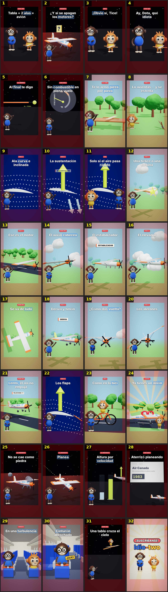

# Storyboard: avion3d-anim (3d)

| panel | scene | t (s) | type | title | stat |
|---|---|---|---|---|---|
| 1 | hook | 2.48 | question | Tabla + 2 alas = avión |  |
| 2 | off | 7.58 | question | ¿Y si se apagan los motores? |  |
| 3 | obvio | 11.15 | object | ¡Obvio sí, Tico! |  |
| 4 | idiot | 13.35 | object | Ay, Dota, qué idiota |  |
| 5 | promise | 15.94 | object | Al final te digo |  |
| 6 | fuel | 20.11 | question | Sin combustible en pleno vuelo |  |
| 7 | armo | 23.53 | process | Te lo armo pieza por pieza |  |
| 8 | crash | 25.82 | object | Lo avientas… y se estrella |  |
| 9 | wing | 30.09 | process | Ala curva e inclinada |  |
| 10 | lift | 34.95 | object | La sustentación |  |
| 11 | vuela | 40.16 | comparison | Solo si el aire pasa rápido |  |
| 12 | turb | 44.22 | object | Una hélice o una turbina |  |
| 13 | motor | 48.8 | process | Ese es el motor |  |
| 14 | pitch | 54.54 | question | El avión cabecea |  |
| 15 | stab | 59.35 | object | El estabilizador |  |
| 16 | elev | 64.21 | process | El elevador |  |
| 17 | yaw | 68.73 | question | Se va de lado |  |
| 18 | fin | 74.47 | object | Deriva y timón |  |
| 19 | roll | 79.6 | question | ¿Cómo das vuelta? |  |
| 20 | ail | 85.11 | process | Los alerones |  |
| 21 | slow | 91.01 | question | Lento, el ala no empuja |  |
| 22 | flaps | 97.35 | object | Los flaps |  |
| 23 | bike | 103.34 | object | Como en la bici |  |
| 24 | felicidades | 110.33 | object | Ya tienes un avión |  |
| 25 | rock | 117.14 | question | No se cae como piedra |  |
| 26 | glide | 121.52 | process | Planea |  |
| 27 | trade | 125.47 | comparison | Altura por velocidad |  |
| 28 | canada | 131.51 | stat | Aterrizó planeando |  |
| 29 | turbu | 137.22 | object | En una turbulencia |  |
| 30 | belt | 141.48 | closing | Cinturón abrochado |  |
| 31 | outro | 145.26 | closing | Una tabla cruza el cielo |  |
| 32 | sub | 149.71 | closing |  |  |
