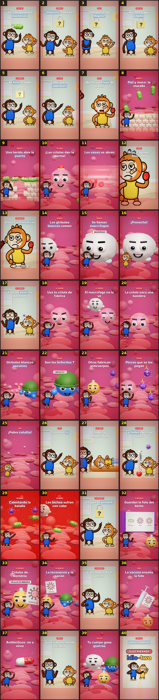

# Storyboard: defensas (3d)

| panel | scene | t (s) | type | title | stat |
|---|---|---|---|---|---|
| 1 | hook | 2.93 | question | Tu cuerpo mata bacterias |  |
| 2 | varicela | 7.12 | question | ¿Varicela 2 veces? |  |
| 3 | flojera | 10.36 | object | ¡Porque le da flojera! |  |
| 4 | idiota | 13.31 | object | Ay, Dota, qué idiota |  |
| 5 | promesa | 16.33 | object | Al final te digo |  |
| 6 | adentro | 20.24 | process | ¿Qué pasa adentro? |  |
| 7 | auch | 23.8 | object | ¡Auch, una hoja de papel! |  |
| 8 | piel | 27.56 | process | Piel y moco: la muralla |  |
| 9 | puerta | 32.54 | process | Una herida abre la puerta |  |
| 10 | alarma | 36.65 | process | ¡Las células dan la alarma! |  |
| 11 | vasos | 40.05 | process | Los vasos se abren |  |
| 12 | roja | 43.68 | object | Roja, caliente, hinchada |  |
| 13 | inflam | 46.53 | object | Eso es inflamación |  |
| 14 | comelones | 51.46 | process | Los glóbulos blancos comen |  |
| 15 | macro | 55.27 | object | Se llaman macrófagos |  |
| 16 | provecho | 57.66 | object | ¡Provecho! |  |
| 17 | virus | 59.99 | question | Con un virus es diferente |  |
| 18 | fabrica | 64.1 | process | Usa tu célula de fábrica |  |
| 19 | escondido | 67.89 | process | El macrófago no lo ve |  |
| 20 | bandera | 72.25 | process | La célula saca una bandera |  |
| 21 | asesinos | 76.77 | process | Glóbulos blancos asesinos |  |
| 22 | linfo | 79.47 | object | Son los linfocitos T |  |
| 23 | anticuerpos | 82.75 | process | Otras fabrican anticuerpos |  |
| 24 | pinzas | 86.82 | process | Pinzas que se les pegan |  |
| 25 | pobre | 89.85 | object | ¡Pobre celulita! |  |
| 26 | ella | 92.54 | object | Era ella o tú |  |
| 27 | fiebre | 95.65 | process | Sube la temperatura |  |
| 28 | noesvirus | 98.12 | object | La fiebre no es el virus |  |
| 29 | calor | 101 | process | Calentando la batalla |  |
| 30 | sudan | 105.49 | process | Los bichos sufren con calor |  |
| 31 | prometi | 108.84 | object | Lo que te prometí |  |
| 32 | foto | 113.06 | process | Guardan la foto del bicho |  |
| 33 | memoria | 116.32 | object | Células de memoria |  |
| 34 | regresa | 119.99 | process | La reconocen y la sacan |  |
| 35 | dosveces | 123.1 | stat | Casi nunca da 2 veces |  |
| 36 | vacuna | 127.08 | process | La vacuna enseña la foto |  |
| 37 | antibio | 131.24 | object | Antibióticos: no a virus |  |
| 38 | receta | 135.57 | object | Solo si lo receta un médico |  |
| 39 | guerras | 140.2 | closing | Tu cuerpo gana guerras |  |
| 40 | sub | 144.32 | closing | ¡Suscríbanse! |  |
