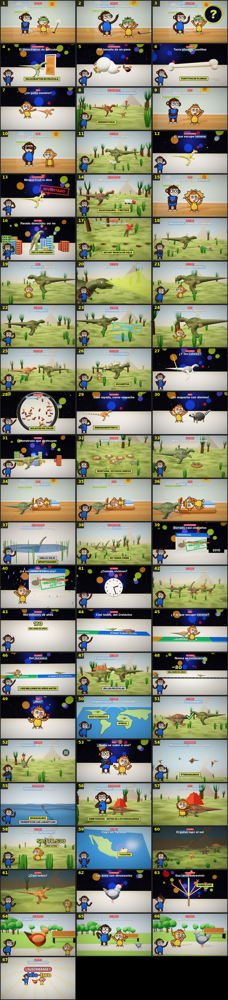

# Storyboard: dinos (3d)

| panel | scene | t (s) | type | title | stat |
|---|---|---|---|---|---|
| 1 | hook | 2.08 | object | ¡Soy un T. rex! |  |
| 2 | mintieron | 4.73 | object | Las películas te mintieron |  |
| 3 | promesa | 8.49 | object | Un dinosaurio vivo |  |
| 4 | famoso | 15.89 | object | El Velociraptor de película |  |
| 5 | pavo | 20.95 | comparison | Del tamaño de un pavo |  |
| 6 | hueso | 27.16 | object | Tenía plumas: puntitos |  |
| 7 | pollo | 31.8 | object | ¿Un pollo asesino? |  |
| 8 | deino | 38.93 | comparison | Se basaron en el Deinonychus |  |
| 9 | chido | 44.87 | object | ¡Quiero un nombre chido! |  |
| 10 | mereces | 47.7 | object | El que te mereces |  |
| 11 | peor | 51.44 | object | Lo del T. rex es peor |  |
| 12 | dilofake | 56 | object | El que escupe veneno |  |
| 13 | inventado | 60.39 | object | Ningún fósil lo dice |  |
| 14 | dilo | 65.13 | comparison | Medía unos 7 metros |  |
| 15 | disfraz | 69.7 | object | ¡La gorguera es un disfraz! |  |
| 16 | rey | 75.44 | object | Parado derechito: así no |  |
| 17 | huellas | 79.91 | object | Sin marcas de cola |  |
| 18 | subibaja | 85.11 | process | Horizontal, como un subibaja |  |
| 19 | quieto | 89.3 | object | ¡Si no te mueves no te ve! |  |
| 20 | ojos | 96 | object | Veía muy bien |  |
| 21 | mejor | 102.5 | object | Si te quedas quieto… |  |
| 22 | rugido | 108.57 | question | ¿Y el rugido? |  |
| 23 | retumbo | 116.8 | object | Un retumbo grave |  |
| 24 | plumasrex | 121.87 | question | ¿También tenía plumas? |  |
| 25 | yuty | 126.59 | comparison | Yutyrannus: con plumas |  |
| 26 | escamas | 134.77 | object | El T. rex: escamitas |  |
| 27 | colores | 143.04 | question | ¿Y los colores? |  |
| 28 | bolsitas | 149.22 | object | Bolsitas de color |  |
| 29 | sino | 156.62 | comparison | Cola rayada, como mapache |  |
| 30 | dientes | 162.09 | object | ¡Un mapache con dientes! |  |
| 31 | monstruos | 165.93 | object | Monstruos que destruyen |  |
| 32 | nidos | 174.21 | process | Nidos en Montana |  |
| 33 | madre | 183.66 | process | Maiasaura: buena madre |  |
| 34 | enfermo | 188.66 | object | ¡Como mi mamá! |  |
| 35 | toneladas | 193.17 | object | Varias toneladas |  |
| 36 | shh | 197.3 | object | ¡Shhh, que te oye! |  |
| 37 | lago | 204.86 | object | El Brontosaurio en el lago |  |
| 38 | tierra | 211.22 | process | Vivían en tierra firme |  |
| 39 | borrado | 219.11 | object | Borrado casi cien años |  |
| 40 | contratar | 225.83 | object | ¡Lo volvieron a contratar! |  |
| 41 | cuando | 231.34 | question | ¿Cuándo vivieron? |  |
| 42 | vecinos | 236.68 | object | Todos juntos, como vecinos |  |
| 43 | tres | 244.6 | process | 160 millones de años |  |
| 44 | cretacico | 253.71 | process | Casi todos, del Cretácico |  |
| 45 | escupe | 258.45 | question | ¿Y el que escupe veneno? |  |
| 46 | jurasico | 263.99 | process | Del Jurásico |  |
| 47 | pelea | 268.94 | comparison | Estegosaurio contra T. rex |  |
| 48 | linea | 274.03 | process | Nunca se conocieron |  |
| 49 | mas | 277.81 | question | ¿Más? |  |
| 50 | espino | 282.51 | comparison | Espinosaurio: otro continente |  |
| 51 | trike | 288.57 | comparison | T. rex y Triceratops: ¡sí! |  |
| 52 | humanos | 297.21 | process | Los humanos llegaron después |  |
| 53 | nadie | 304.46 | question | ¿Nadie se subió a uno? |  |
| 54 | ptero | 310.99 | object | Pterosaurios: no dinosaurios |  |
| 55 | mosa | 316.85 | object | El mosasaurio, tampoco |  |
| 56 | dimetro | 323.1 | object | Dimetrodon: pariente tuyo |  |
| 57 | primo | 327.03 | object | ¡Ese es mi primo! |  |
| 58 | acabaron | 330.68 | question | ¿Por qué se acabaron? |  |
| 59 | asteroide | 338.18 | process | Cayó en Yucatán |  |
| 60 | polvo | 345.08 | process | El polvo tapó el sol |  |
| 61 | casi | 350.88 | question | ¿Casi todos? |  |
| 62 | aves | 359.85 | process | Las aves son dinosaurios |  |
| 63 | rama | 366.03 | object | Esa rama sobrevivió |  |
| 64 | gallina | 371.38 | object | La gallina es un dinosaurio |  |
| 65 | consejo | 377.49 | object | Disfrútala, pero no le creas |  |
| 66 | palomas | 382.44 | object | Mira las palomas |  |
| 67 | sub | 387.35 | closing | ¡Suscríbanse! |  |
