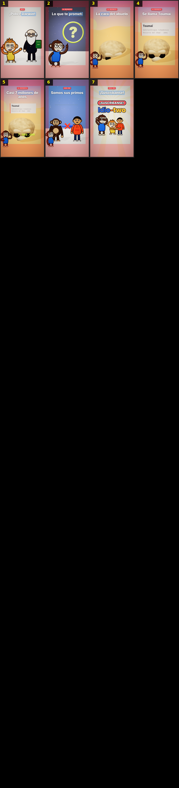

# Storyboard: primos (3d)

| panel | scene | t (s) | type | title | stat |
|---|---|---|---|---|---|
| 1 | hook | 2.69 | question | ¿Venimos del chango? |  |
| 2 | guapo | 6.35 | object | ¡Soy el más guapo! |  |
| 3 | idiota | 9.27 | object | Ay, Dota, qué idiota |  |
| 4 | nunca | 12.23 | process | Nunca venimos del chango |  |
| 5 | promesa | 15.94 | object | La cara del abuelo |  |
| 6 | primo | 19.05 | comparison | Piensa en tu primo |  |
| 7 | mismo | 21.18 | comparison | Tienen el mismo abuelo |  |
| 8 | igual | 23.22 | comparison | Con el chimpancé, igual |  |
| 9 | hace | 27.75 | stat | Hace 7 millones de años |  |
| 10 | ramas | 31.59 | process | Su familia se partió en 2 |  |
| 11 | una | 33.71 | process | Una terminó en el chimpancé |  |
| 12 | otra | 37.53 | process | Otra terminó en ti |  |
| 13 | otraesp | 41.89 | object | Era otra especie |  |
| 14 | existe | 44.39 | object | Ya no existe |  |
| 15 | esperando | 46.8 | question | ¿Se quedó esperando? |  |
| 16 | tampoco | 51.44 | process | Lleva 7 millones cambiando |  |
| 17 | prueba | 55.3 | object | La prueba: el ADN |  |
| 18 | genoma | 58.97 | object | 2005: leen el ADN |  |
| 19 | letras | 61.82 | comparison | Al comparar letra a letra |  |
| 20 | cien | 66.05 | stat | 1 de cada 100 |  |
| 21 | gemelos | 70.06 | object | ¡Casi gemelos! |  |
| 22 | raro | 75.15 | comparison | 24 pares contra 23 |  |
| 23 | falta | 78.64 | question | ¿Dónde quedó el par? |  |
| 24 | dentro | 80.57 | object | Dentro de tu cromosoma 2 |  |
| 25 | tapita | 84.38 | object | Una tapita en cada punta |  |
| 26 | mitad | 89.14 | process | 2 tapitas pegadas |  |
| 27 | fundieron | 93.99 | process | Se fundieron en uno |  |
| 28 | darwin | 98.01 | object | Darwin ya lo dijo en 1871 |  |
| 29 | ningun | 101.43 | comparison | No era ningún chango |  |
| 30 | revista | 104.62 | object | Una revista lo dibujó |  |
| 31 | hoy | 107.38 | process | Esa idea se quedó |  |
| 32 | pobre | 109.66 | object | ¡Pobre Darwin! |  |
| 33 | prometi | 111.88 | object | Lo que te prometí |  |
| 34 | cara | 114.34 | object | La cara del abuelo |  |
| 35 | toumai | 116.33 | object | Se llama Toumaï |  |
| 36 | craneo | 119.97 | stat | Casi 7 millones de años |  |
| 37 | primos | 124.61 | closing | Somos sus primos |  |
| 38 | sub | 129.37 | closing | ¡Suscríbanse! |  |
